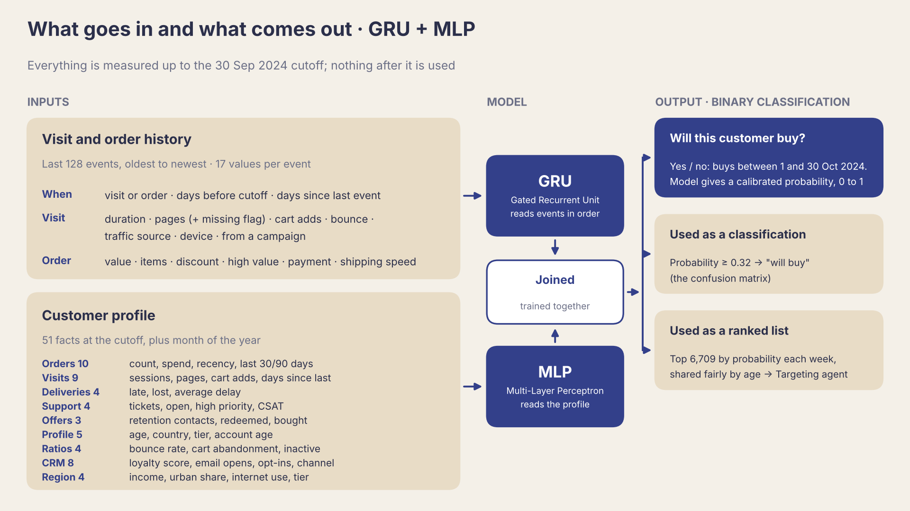

# Egus's Deep Learning Model: GRU + MLP (TwoBranchNet), run E7

> **Team base model.** This model won the PR1 bake-off (19 Nov 2026) and is the model the team's agents
> build on. Owner: Egus (team lead). Every file in `models/egus/` is mine; my work in shared folders
> starts with `egus_` or is listed below.

## For the assessor: where to find my work
| What | Where |
|---|---|
| Model card (this page) | `models/egus/README.md` |
| Data cleaning and EDA, browsing tables (my allocated part, "Person A") | [`data_prep/personA_browsing.ipynb`](../../data_prep/personA_browsing.ipynb) |
| What the cleaned browsing data contains, and every fix made | [`data_prep/personA_browsing_output/`](../../data_prep/personA_browsing_output/): the cleaned files (`sessions.csv.gz`, `geo_data.csv`, `campaign_daily_performance.csv`), data dictionary and `quality_log.csv` |
| My own baseline: LightGBM (03), and how E7 compares with it | [`baseline_03/README.md`](baseline_03/README.md) |
| Training code (Python package) | [`src/shopsphere_dl/`](src/shopsphere_dl/), code map in section 7 |
| Training and tuning runs (Kaggle, GPU) | [`notebooks/kaggle_e7_train.ipynb`](notebooks/kaggle_e7_train.ipynb), [`notebooks/kaggle_e7t_tune.ipynb`](notebooks/kaggle_e7t_tune.ipynb) |
| Results in the team format | [`results/metrics.json`](results/metrics.json) |
| Comparisons, significance tests, fairness | [`results/`](results/): `compare_*`, `bootstrap_*` (incl. `bootstrap_e7_vs_03.csv`), `bias_e7.csv`, `confusion_matrix_e7_seed1.png` |
| Shared split files | [`folds.csv`](folds.csv) (5 customer folds), [`holdout_8020_ids.csv`](holdout_8020_ids.csv) (team holdout) |
| Test-set predictions | [`results/test_E7.csv`](results/test_E7.csv) |
| Tests | [`tests/`](tests/) (51 passed, 3 skipped) |
| Trained weights | GitHub Release `egus-e7-v1` (link in section 5) |
| PR1 slides and charts | [`docs/slides/`](../../docs/slides/), files starting `egus_` |
| AI Use Log | [`docs/ai_use_logs/egus.md`](../../docs/ai_use_logs/egus.md) |

**PR1 rubric → evidence**
| Criterion | Evidence |
|---|---|
| Input Data: collection, EDA and preparation | `personA_browsing.ipynb`: every issue found, the decision taken and the chart behind it; summary and questions in section 8 |
| Supervised Model: training | `train.py`, `tune.py`; cutoff ruling applied and tested (section 3a); `best_params.json` (Optuna, 30 trials); the E7T re-tune that tied and was not adopted |
| Supervised Model: evaluation | `metrics.json` (team holdout); `compare_*` (against `02` and my own baseline `03`); `bootstrap_*` (paired bootstrap); `bias_e7.csv` (fairness by age and region) |
| Source Codes: structure | One module per step (section 7), docstrings on every module, tests for leakage and features |
| AI Use Log | `docs/ai_use_logs/egus.md` |

My commits: GitHub → Insights → Contributors, or `git log --author="EatGuss"`.

## 1. Overview
A two-branch PyTorch network that predicts whether a customer buys between 1 and 30 Oct 2024.

- **Sequence branch:** the customer's last 128 sessions and orders, oldest to newest (17 values per event:
  9 numbers such as duration, pages and cart adds; 2 timing values in days before the cutoff; 6 categories
  such as event type, device and traffic source). Each event is projected to 128 numbers and read by a GRU
  (1 layer, width 128). Attention pooling turns the GRU's memory over all events into one 128-number summary.
  A learned start token handles customers with no history.
- **Static branch:** 51 customer facts (47 numeric, 4 categories as learned embeddings) through an MLP 256 → 128.
  E7 adds profile (CRM) columns and region data to the 39 base features.
- **Head:** the two summaries are concatenated (256) → 128 → 64 → 1 logit, then divided by a per-model
  temperature (calibration) and passed through a sigmoid. Both branches and the head are trained together
  with one loss (BCE); it is one network, not two models.

## 2. Validation & Training Setup
- **Data:** the team's combined `shopsphere.db`. Strict 30 Sep 2024 cutoff; profile columns are blank on
  earlier snapshots; retention contact outcomes after 16 Sep 2024 are treated as unknown.
- **Training rows:** 13 rolling monthly snapshots (cutoffs Sep 2023 to Sep 2024, 700,217 rows), each labelled
  with a purchase in the 30 days after its cutoff, as approved by the lecturer on 5 Nov 2026.
- **Validation:** 5 customer folds (`folds.csv`: `StratifiedKFold(5, shuffle=True, random_state=42)`,
  the same split as baseline `02` used before the 80/20 change). Every customer is scored by the fold model
  that never saw them, so the team's 80/20 holdout customers (`holdout_8020_ids.csv`, 12,800) are scored
  without leakage.
- **Settings:** `best_params.json` (Optuna, 30 trials on fold 0): hidden 128, 1 GRU layer, dropout 0.012,
  learning rate 0.00118, 128 events, up to 30 epochs. A wider re-tune (E7T, `best_params_E7T.json`) tied on
  every measure, so these settings were kept.
- **Seeds:** seed 1 for the bake-off; the deployed model averages 5 seeds × 5 folds = 25 models.

## 3. Training Notebook and Code
- `notebooks/kaggle_e7_train.ipynb`: Kaggle run "ShopSphere E7" (GPU T4). Inputs: a dataset with
  `shopsphere.db` and `folds.csv`, and a dataset with a zip of this folder.
- `notebooks/kaggle_e7t_tune.ipynb`: the re-tune (E7T).
- `src/shopsphere_dl/`: the package (features, sequences, model, training, tuning, export, prediction, fairness).
- `tests/`: `pytest tests` with the environment below set (leakage, extra features, fairness, model,
  prediction; 51 passed, 3 skipped on 19 Nov).
- `scripts/compare_e7.py`: comparison tables, paired bootstrap and bias check.

```bash
pip install -r requirements.txt
export PYTHONPATH=src SHOPSPHERE_DB=shopsphere.db SHOPSPHERE_FOLDS=folds.csv
python -m shopsphere_dl.train --run E4 --seed 1 --params best_params.json --name E7 --extra crm,geo
python -m shopsphere_dl.export --run E7 --base E4 --params best_params.json --extra crm,geo \
    --ckpt-dir <checkpoints> --oof-dir <oof files> --out weights/e7_v1
python -m shopsphere_dl.predict --bundle weights/e7_v1 --who test --out results/test_E7_scores.csv
```

## 3a. Cutoff compliance (lecturer's strict ruling, 5 Nov 2026)
Every rule is applied in code at every snapshot and checked by a test (`tests/`, all passing).

| Rule | Applied in | Checked by |
|---|---|---|
| No date after the cutoff in any table | `cutoff_rules.as_of()`: every table is cut at each snapshot's cutoff | `test_no_date_after_cutoff` |
| Retention outcomes (`purchased_within_14d`, `redeemed`) known only once their 14-day window has closed: contacts after 16 Sep 2024 count as unknown | `cutoff_rules.as_of()` | `test_contact_outcomes_14_days` |
| Delivery delay known only when the promised and delivered dates are both by the cutoff | `cutoff_rules.as_of()` | `test_no_date_after_cutoff` |
| Nothing after the cutoff can change a feature | all feature code reads `as_of()` tables only | `test_truncate_and_compare` (cutting the data at the cutoff gives identical features), `test_future_scramble` (scrambling everything after the cutoff changes nothing) |
| Event sequences stop at each row's cutoff | `sequences.EventStore` | `test_sequences_respect_cutoff` |
| Profile (CRM) columns, known only at 30 Sep 2024, are blank on earlier snapshots | `features_extra.add_extra()` | `test_crm_blank_on_every_earlier_snapshot` |
| Browsing data (my cleaning part) | `personA_browsing.ipynb` checks dates: 0 sessions after 30 Sep 2024 | chart 1 and `quality_log.csv` |
| My own baseline 03 | `baseline_03/rerun_03_strict_cutoff.py` applies the ruling to the notebook's SQL | re-run reproduces the saved scores |

## 4. Evaluation & Results (team 80/20 holdout, 12,800 customers)
| | GRU + MLP seed 1 | GRU + MLP 5 seeds | LightGBM `02` seed 42 (team-reported) |
|---|---|---|---|
| ROC-AUC | **0.8761** | **0.8771** | 0.8752 |
| PR-AUC | **0.5757** | **0.5784** | 0.5725 |
| F1 (best threshold) | 0.5459 (0.32) | 0.5477 (0.26) | 0.5486 (0.64) |
| Recall | 58.18% | 67.88% | 66.49% |
| Precision | 51.42% | 45.90% | 46.69% |

Team rule (ROC-AUC change + PR-AUC change over `02`): seed 1 **+0.0041**, 5 seeds **+0.0078**.
Threshold rule: best F1 over `np.arange(0.2, 0.8, 0.01)`, as in the `02` notebook. At the same list size as
`02` (2,656 customers), seed 1 recall is 66.06% against 66.49%.

All 64,000 training customers (5-fold, 5 seeds): ROC-AUC 0.8752, PR-AUC 0.5802, P@1000 0.884, P@2500 0.786,
ECE 0.0048. Against my own tuned LightGBM (`baseline_03/`): PR-AUC +0.0063, P@2500 +0.017 and P@6709 +0.006
(paired-bootstrap wins); ROC-AUC and P@1000 tie.

Fairness: scores are calibrated in every age band and region tier. For the weekly contact list (6,709),
equal-opportunity allocation by age (`fairness.allocate`) cuts the age gap in recall from 18.1 to 2.3 points
for −0.005 precision (`results/bias_e7.csv`).

## 5. Files
- `results/metrics.json`: holdout metrics in the team format.
- `results/oof_E7_seed1..5.csv`: out-of-fold scores (`customer_id, fold, seed, score`).
- `results/holdout_E7.csv`: holdout scores, seed 1 and 5-seed mean.
- `results/test_E7.csv`: test-set scores of the 25-model E7 (`customer_id, target_probability, target`;
  `target` = 1 where the probability is at least 0.26).
- `results/compare_*`, `bootstrap_*`, `bias_e7.csv`, `confusion_matrix_e7_seed1.png`.
- Weights (25 models, preprocessors and temperatures): GitHub Release `egus-e7-v1`, file `e7_v1.zip`.
  Link: https://github.com/PravinRram/ShopSphere/releases/tag/egus-e7-v1

## 6. Inputs and output


The output is a **binary classification**: will the customer buy between 1 and 30 Oct 2024? The model
gives a calibrated probability (0 to 1). It is used as a yes/no answer (probability ≥ 0.32, seed 1) and as a
ranked list: the top 6,709 each week, shared fairly by age, go to the Targeting agent.

## 7. Code map (`src/shopsphere_dl/`)
| Module | What it does |
|---|---|
| `cutoff_rules.py` | Every table exactly as known at a cutoff date, so no feature can look past it |
| `snapshots.py` | The 13 monthly snapshots and their 30-day purchase labels |
| `features_static.py` | The 39 base customer features |
| `features_extra.py` | Profile (CRM) and region features; profile columns blanked on earlier snapshots |
| `sequences.py` | Each customer's last 128 sessions and orders as event sequences |
| `dataset.py` | Missing flags, scaling and category codes, fitted on training rows only |
| `model.py` | TwoBranchNet: GRU + attention, MLP, joined head, temperature |
| `folds.py` | Which snapshot rows train and validate each fold |
| `train.py`, `tune.py` | Training with early stopping; Optuna search |
| `evaluate.py` | Shared metrics (ROC-AUC, PR-AUC, precision@k, ECE) and the paired bootstrap |
| `export.py`, `predict.py` | Package the 25 models and score customers |
| `fairness.py` | Equal-opportunity allocation for the contact list |

## 8. Notes
- `shopsphere.db` caps sessions over 5 h at 4 h. The browsing cleaning (`data_prep/personA_browsing.ipynb`)
  blanks them instead; adopting that rule needs a rebuild of the database and a retrain (planned for PR2).
- Code written with Claude (claude.ai). See `docs/ai_use_logs/egus.md`.
